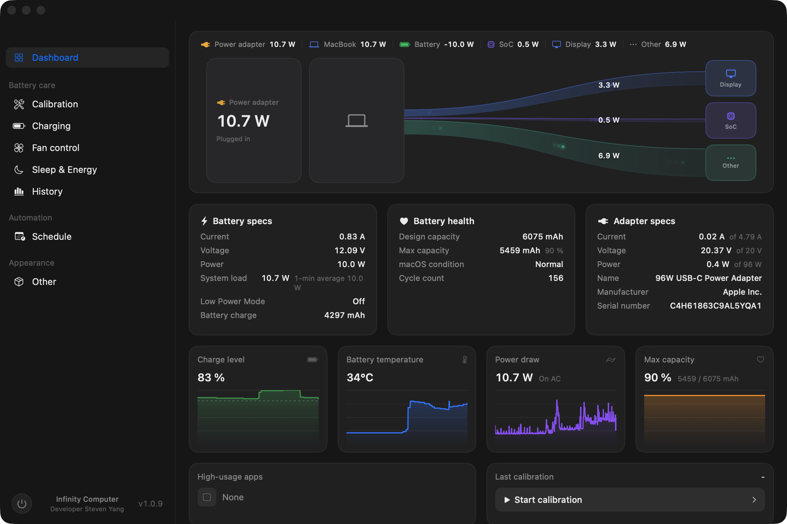

<div align="center">

# InfiniCal

**macOS battery health and charging control**

English · [简体中文](README.md)

[](https://github.com/stevenjx/InfiniCal/releases) [](https://github.com/stevenjx/InfiniCal/releases) [](https://github.com/stevenjx/InfiniCal/releases)

<p>
  
</p>

</div>

## At a glance

InfiniCal reads local IORegistry, SMC and IOHID data to **measure real battery health** and control charging, discharge and cooling. Unavailable values are shown as `--` rather than fabricated estimates.

## Features

| Area | What it does |
| --- | --- |
| Battery calibration | Controlled charge, discharge, recharge, rest and settle cycle with measured capacity, health, coulombic efficiency and DCIR |
| Charging | Charge limits, sub-80% limits where supported, automatic discharge, sailing mode and overheat protection |
| Fan control | Automatic, custom, full-speed and temperature-curve modes |
| Live monitoring | Charge level, current, voltage, power, temperature, adapter and fan data |
| History and reports | Calibration history, TXT reports and CSV telemetry export |
| Localisation | Follow the system, Chinese or English UI |

## Download

Get the latest version from [Releases](https://github.com/stevenjx/InfiniCal/releases).

**Current version: 1.0.12** · universal arm64 + x86_64 package · macOS 12 Monterey or later

> The app is ad-hoc signed and not notarized by Apple. macOS may require approval on first launch.

## Build

```bash
./build.sh
open build/InfiniCal.app
```

Requires Xcode 16 or newer, or Command Line Tools with a Swift 6 toolchain.

## Permissions and compatibility

Reading telemetry does not require privileges. Writing the SMC and controlling charging or fans requires the privileged helper; the app requests administrator authorization when needed.

Apple Silicon and Intel/T2 use different hardware control paths. Available features depend on the Mac model, firmware and macOS version.

## Licence

Copyright © 2026 Infinity Computer. All rights reserved.

The interface and interaction take cues from AlDente Pro's public design; all code and assets are independent.
