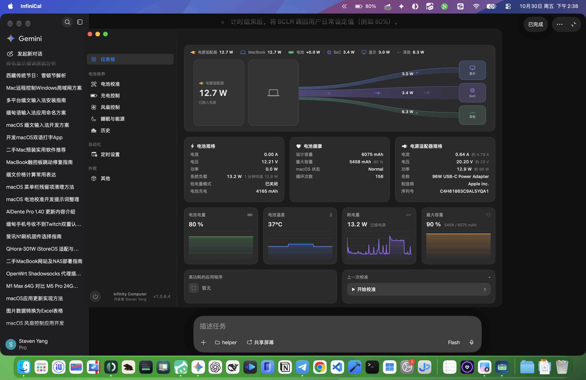

# InfiniCal

[English](README.en.md) · 简体中文

macOS 电池工具：测量真实电池健康，并控制充电、放电与散热。



## 功能

- **电池校准**：受控完成满充、放电、复充、静置与回落，输出真实容量、健康度、库仑效率和 DCIR。
- **充电控制**：充电上限、低于 80% 的限制、自动放电、航海模式、过热保护。
- **风扇控制**：自动、自定义、全速和温度曲线。
- **实时监控**：电量、电流、电压、功耗、温度、适配器和风扇。
- **历史与报告**：保存校准记录，导出 TXT 报告和 CSV 遥测数据。
- **本地化界面**：支持跟随系统、中文或英文。

## 下载

前往 [Releases](https://github.com/stevenjx/InfiniCal/releases) 下载最新版本。

当前版本：**1.0.9**（arm64 + x86_64 通用包，macOS 12 Monterey 及以上）。

> 应用使用 ad-hoc 签名，未经 Apple 公证。首次打开可能需要在系统设置中允许运行。

## 构建

```bash
./build.sh
open build/InfiniCal.app
```

需要 Xcode 16 或更新版本，或包含 Swift 6 工具链的 Command Line Tools。

## 权限

读取数据不需要特权。写入 SMC、控制充电和风扇需要安装特权助手，应用会在需要时请求管理员授权。

## 说明

InfiniCal 直接读取本机 IORegistry、SMC 和 IOHID 数据；无法读取的值显示为 `--`，不会伪造估算值。

Apple Silicon 与 Intel/T2 使用不同的硬件控制路径，具体能力取决于机型、固件和 macOS 版本。

## 许可

Copyright © 2026 Infinity Computer. All rights reserved.

界面与交互参考了 AlDente Pro 的公开设计，代码与资源均为独立实现。
