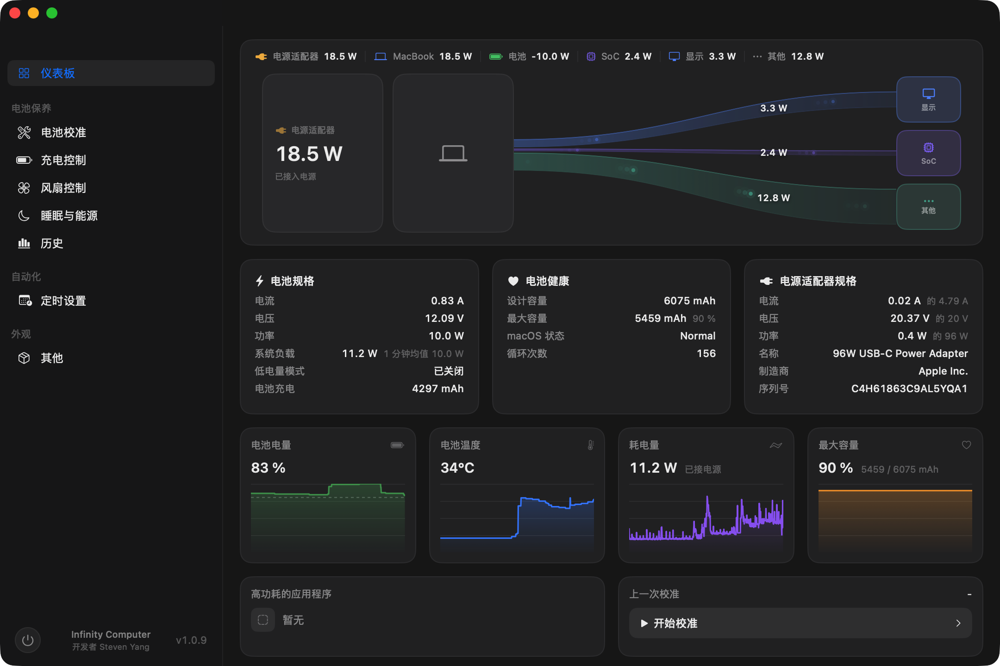

<div align="center">

# InfiniCal

**macOS battery health and charging control**

English · [简体中文](#简体中文)

[](https://github.com/stevenjx/InfiniCal/releases) [](https://github.com/stevenjx/InfiniCal/releases) [](https://github.com/stevenjx/InfiniCal/releases)

<p>
  
</p>

</div>

## At a glance

InfiniCal reads local IORegistry, SMC and IOHID data to **measure real battery health** and control charging, discharge and cooling. Unavailable values are shown as `--` rather than fabricated estimates.

## Features

| Area | What it does |
| --- | --- |
| Battery calibration | Controlled charge, discharge, recharge, rest and settle cycle with measured capacity, health, coulombic efficiency and DCIR |
| Charging | Charge limits, sub-80% limits where supported, automatic discharge, sailing mode and overheat protection |
| Fan control | Automatic, custom, full-speed and temperature-curve modes |
| Live monitoring | Charge level, current, voltage, power, temperature, adapter and fan data |
| History and reports | Calibration history, TXT reports and CSV telemetry export |
| Localisation | Follow the system, Chinese or English UI |

## Download

Get the latest version from [Releases](https://github.com/stevenjx/InfiniCal/releases).

**Current version: 1.0.29** · universal arm64 + x86_64 package · macOS 12 Monterey or later

> The app is ad-hoc signed and not notarized by Apple. macOS may require approval on first launch.

## Build

```bash
./build.sh
open build/InfiniCal.app
```

Requires Xcode 16 or newer, or Command Line Tools with a Swift 6 toolchain.

## Automatic updates

The app bundles [Sparkle 2](https://sparkle-project.org) and updates itself from the `appcast.xml` published on GitHub Releases. Archives are verified with an EdDSA signature: the private key stays in the local login keychain and the public half ships as `SUPublicEDKey` in `Info.plist`.

> **The first release with auto-update must be installed manually once.** Versions up to 1.0.14 do not contain Sparkle and cannot update themselves; every release from 1.0.15 onward will be offered automatically.

Release procedure:

```bash
# 1. Bump CFBundleShortVersionString / CFBundleVersion in Resources/Info.plist
#    and the matching MARKETING_VERSION / CURRENT_PROJECT_VERSION in
#    Tools/generate_xcodeproj.py (the gate rejects drift).
./build.sh
python3 Tools/quality_gate.py all
Tools/package_dmg.sh                     # writes dist/InfiniCal-<version>.dmg

# 2. Produce the signed appcast (needs the Sparkle tools).
python3 Tools/make_appcast.py

# 3. Publish, uploading both the DMG and appcast.xml as release assets.
gh release create v<version> dist/InfiniCal-<version>.dmg appcast.xml
```

`Tools/make_appcast.py` skips archives whose app has no `SUPublicEDKey` and explains why.

## Permissions and compatibility

Reading telemetry does not require privileges. Writing the SMC and controlling charging or fans requires the privileged helper; the app requests administrator authorization when needed.

Apple Silicon and Intel/T2 use different hardware control paths. Available features depend on the Mac model, firmware and macOS version.

## Licence

Copyright © 2026 Infinity Computer. All rights reserved.

The interface and interaction take cues from AlDente Pro's public design; all code and assets are independent.

---

<div align="center">

## 简体中文

**macOS 电池健康与充电控制工具**

<p>
  
</p>

</div>

## 一句话介绍

InfiniCal 从本机 IORegistry、SMC 和 IOHID 读取数据，用于**测量真实电池健康**，并控制充电、放电与散热。读不到的数据显示为 `--`，不伪造估算值。

## 功能

| 模块 | 能力 |
| --- | --- |
| 电池校准 | 满充、受控放电、复充、静置与回落；输出真实容量、健康度、库仑效率和 DCIR |
| 充电控制 | 充电上限、低于 80% 的限制、自动放电、航海模式、过热保护 |
| 风扇控制 | 自动、自定义、全速和温度曲线 |
| 实时监控 | 电量、电流、电压、功耗、温度、适配器和风扇 |
| 历史与报告 | 校准记录、TXT 报告和 CSV 遥测数据 |
| 本地化 | 跟随系统、中文或英文界面 |

## 下载

前往 [Releases](https://github.com/stevenjx/InfiniCal/releases) 下载最新版本。

**当前版本：1.0.29** · arm64 + x86_64 通用包 · macOS 12 Monterey 及以上

> 应用使用 ad-hoc 签名，未经 Apple 公证。首次打开可能需要在系统设置中允许运行。

## 构建

```bash
./build.sh
open build/InfiniCal.app
```

需要 Xcode 16 或更新版本，或包含 Swift 6 工具链的 Command Line Tools。

## 自动更新

应用内置 [Sparkle 2](https://sparkle-project.org)，从 GitHub Release 的 `appcast.xml` 检查并安装更新。更新包使用 EdDSA 签名校验：私钥保存在本机登录钥匙串，公钥写在 `Info.plist` 的 `SUPublicEDKey`。

> **首个带自动更新的版本必须手动安装一次。** 1.0.14 及更早的版本不包含 Sparkle，
> 无法自我更新；从 1.0.15 起才会收到更新提示。

发版流程：

```bash
# 1. 提升 Resources/Info.plist 的版本号与 build 号，并同步
#    Tools/generate_xcodeproj.py 里的 MARKETING_VERSION / CURRENT_PROJECT_VERSION
./build.sh
python3 Tools/quality_gate.py all
Tools/package_dmg.sh                     # 产出 dist/InfiniCal-<版本>.dmg

# 2. 生成带 EdDSA 签名的 appcast（需要 Sparkle 工具）
python3 Tools/make_appcast.py

# 3. 创建 Release，上传 DMG 与 appcast.xml 两个资产
gh release create v<版本> dist/InfiniCal-<版本>.dmg appcast.xml
```

`Tools/make_appcast.py` 会跳过不含 `SUPublicEDKey` 的旧包，并提示原因。

## 权限与兼容性

读取数据不需要特权。写入 SMC、控制充电和风扇需要安装特权助手，应用会在需要时请求管理员授权。

Apple Silicon 与 Intel/T2 使用不同的硬件控制路径，具体能力取决于机型、固件和 macOS 版本。

## 许可

Copyright © 2026 Infinity Computer. All rights reserved.

界面与交互参考了 AlDente Pro 的公开设计，代码与资源均为独立实现。
